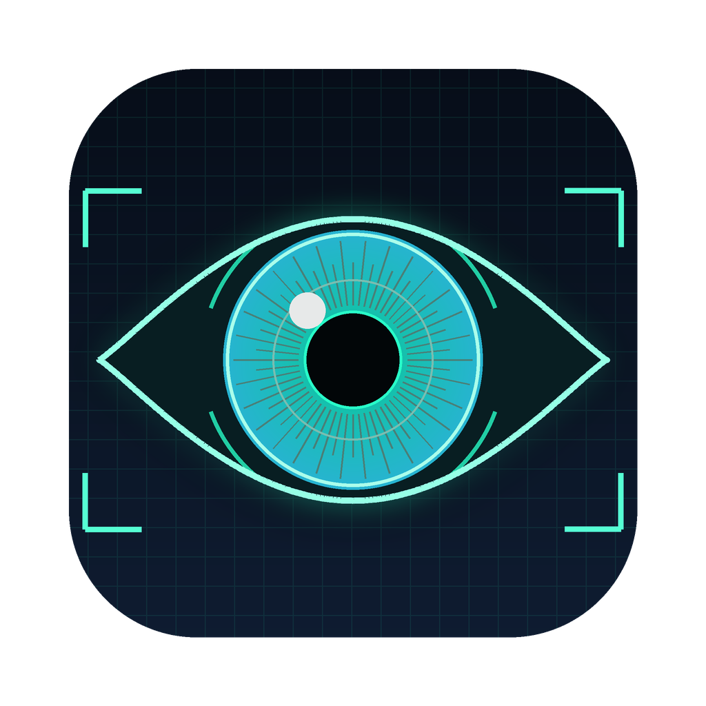
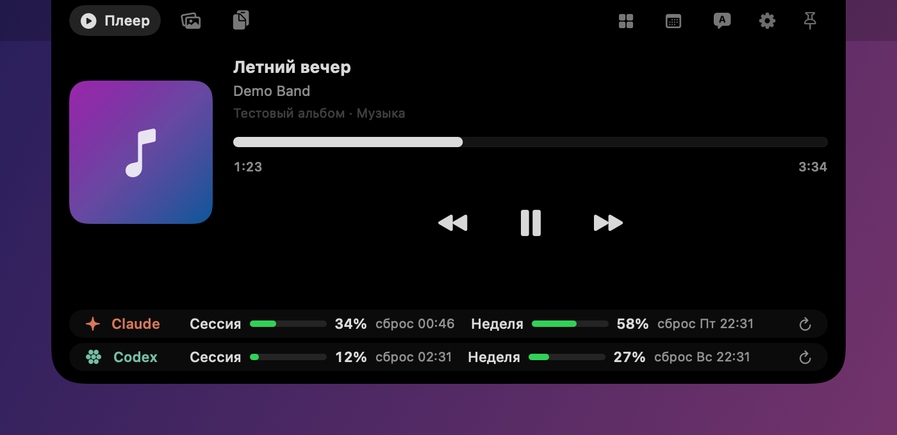
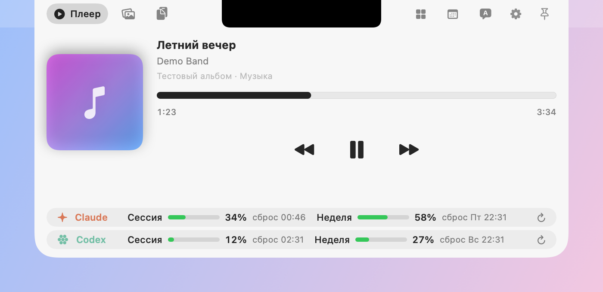
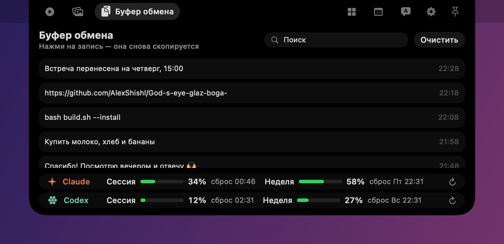
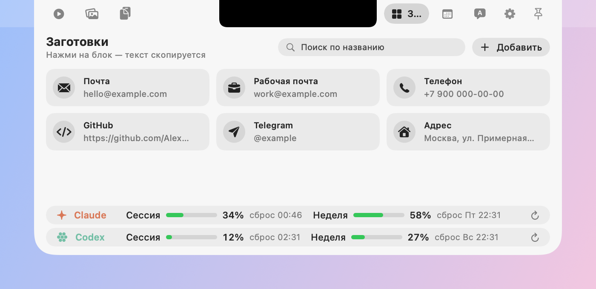
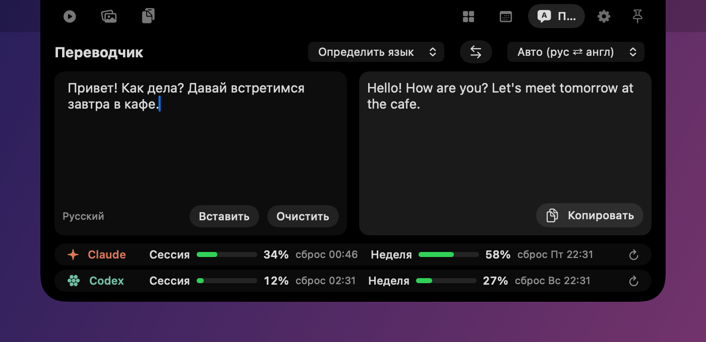
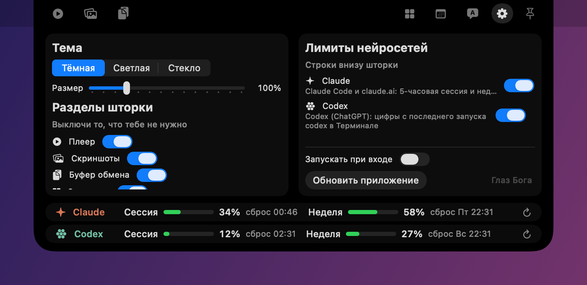

<div align="center">



# Глаз Бога 👁️

**Шторка под вырезом камеры MacBook, в которой живут все мелочи, нужные каждый день.**

Наводишь мышку на «чёлку» вверху экрана, и оттуда выезжает шторка: музыка, свежие скриншоты,
история буфера обмена, заготовки текста, календарь, переводчик и лимиты Claude и Codex.

macOS 14 Sonoma и новее · без интернета работает почти всё

</div>

<p align="center">
  
</p>

---

## Содержание

- [Что умеет](#что-умеет)
- [Скриншоты](#скриншоты)
- [Установка](#установка)
- [Разрешения macOS](#разрешения-macos)
- [Обновление](#обновление)
- [Google Календарь](#google-календарь)
- [Если что-то не так](#если-что-то-не-так)
- [Где хранятся данные](#где-хранятся-данные)

## Что умеет

| | Раздел | Что делает |
|---|---|---|
| ▶️ | **Плеер** | Показывает, что играет, и управляет любым плеером: Музыка, Spotify, YouTube в браузере |
| 🖼️ | **Скриншоты** | Каждый новый скриншот сам попадает сюда. Перетаскивай его в чат, письмо или Finder, удаляй крестиком ×. Хранится 12 часов |
| 📋 | **Буфер обмена** | Последние 60 скопированных текстов с поиском. Нажала на запись, и она снова в буфере. Кнопка «С экрана» (или ⌘⇧2, меняется в настройках): выделяешь область экрана, и текст с неё, даже с картинки, копируется в буфер |
| 🧩 | **Заготовки** | Почта, телефон, GitHub, Telegram и всё, что добавишь сама. Один клик, и текст скопирован |
| 📅 | **Календарь** | Слева встречи и задачи на сегодня и быстрое добавление, справа вся неделя. Дружит с Google Календарём |
| 💬 | **Переводчик** | Пишешь, и перевод появляется сразу. Сам понимает русский ⇄ английский, есть и другие языки |
| ⚙️ | **Настройки** | Тема, размер шторки, какие разделы показывать, лимиты каких нейросетей выводить, автозапуск и обновление |

А внизу шторки всегда видны **лимиты нейросетей**: сколько потрачено у Claude за 5‑часовую сессию и за неделю
и когда сброс. Codex можно включить в настройках.

### Мелочи, которые приятно знать

- 📌 справа закрепляет шторку, чтобы она не пряталась, когда уводишь мышку.
- `Esc` закрывает шторку.
- Иконка 👁 в строке меню: «Открыть Глаз Бога», «Запускать при входе», «Выдать разрешения…», «Обновить…», «Выйти».
- Шторку можно сделать крупнее или компактнее: ползунок **«Размер»** в настройках (от 85% до 150%), стрелочка ↩︎ возвращает 100%.
- Ненужные разделы выключаются в настройках и совсем пропадают из шторки.

### Три темы

| Тёмная | Светлая | Стекло |
|---|---|---|
| Чёрная, сливается с вырезом камеры | Светлая и спокойная | Настоящее жидкое стекло macOS 26 (на старых системах матовое размытие) |

## Скриншоты

<table>
  <tr>
    <td width="50%"><br><sub>Плеер, тёмная тема</sub></td>
    <td width="50%"><br><sub>Плеер, светлая тема</sub></td>
  </tr>
  <tr>
    <td width="50%"><br><sub>Буфер обмена</sub></td>
    <td width="50%"><br><sub>Заготовки</sub></td>
  </tr>
  <tr>
    <td width="50%"><br><sub>Переводчик</sub></td>
    <td width="50%"><br><sub>Настройки: тема, размер, разделы, лимиты</sub></td>
  </tr>
</table>

<sub>На скриншотах примерные данные: трек, заготовки и буфер придуманы для примера.</sub>

## Установка

Займёт минут пять, делается один раз.

1. Открой **Терминал** (⌘ Пробел → «Терминал»).
2. Если Xcode ещё не стоит, поставь инструменты разработчика (появится окошко, нажми «Установить»):
   ```bash
   xcode-select --install
   ```
3. Скачай проект и собери приложение:
   ```bash
   git clone https://github.com/AlexShishl/God-s-eye-glaz-boga- ~/Developer/glaz-boga
   cd ~/Developer/glaz-boga
   bash build.sh --install
   ```
4. Приложение само ляжет в «Программы» и запустится.
   Если macOS скажет «не удаётся проверить разработчика»: открой «Программы», правый клик по «Глаз Бога» → **Открыть** → **Открыть**.
5. В строке меню появится 👁. В её меню можно включить **«Запускать при входе»**.

> Просто собрать без установки: `bash build.sh`. Готовое приложение окажется в папке `build/`.

## Разрешения macOS

Глаз Бога ничего не отправляет на чужие серверы (кроме текста для переводчика), но macOS всё равно спросит
разрешения для некоторых разделов. Каждое нужно только своему разделу: если раздел выключен, разрешение можно не давать.

**Быстрый способ:** в строке меню нажми 👁 → **«Выдать разрешения…»**. Приложение по очереди покажет все системные окошки, останется только нажимать «Разрешить».

| Разрешение | Зачем | Где включить |
|---|---|---|
| **Универсальный доступ** | Чтобы кнопки ⏮ ⏯ ⏭ управляли *любым* плеером, даже YouTube в браузере | Системные настройки → Конфиденциальность и безопасность → **Универсальный доступ** → включи «Глаз Бога». В разделе «Плеер» есть ссылка прямо туда |
| **Связка ключей** | Чтобы читать лимиты Claude Code. Спросит один раз про «Claude Code-credentials» | В окошке нажми **«Разрешать всегда»** |
| **Календарь и Напоминания** | Чтобы показывать и добавлять встречи и задачи | Кнопка «Разрешить доступ» в разделе «Календарь» |
| **Рабочий стол / Документы** | Чтобы забирать новые скриншоты на полку | Спросит при первом скриншоте, нажми «Разрешить» |
| **Автоматизация (Музыка, Spotify)** | Чтобы видеть название трека | Спросит при первом запуске плеера |
| **Запись экрана** | Чтобы «С экрана» в Буфере мог распознать текст в выделенной области | Системные настройки → Конфиденциальность и безопасность → **Запись экрана и системного аудио** → включи «Глаз Бога» и перезапусти его |

> **После каждой пересборки** macOS может забыть про Универсальный доступ и Запись экрана, потому что приложение
> подписано локально. Это нормально: в списке выключи и снова включи «Глаз Бога».

## Обновление

В строке меню нажми 👁 → **«Обновить…»** (или кнопка «Обновить приложение» в настройках шторки).
Откроется Терминал, скачает свежую версию с GitHub, соберёт её и перезапустит приложение.
Ничего распаковывать руками не нужно, заготовки и история остаются на месте.

## Google Календарь

Быстрее всего через кнопку **«Google Календарь»** в настройках шторки ⚙️, она откроет нужное окно. Или вручную: Системные настройки → **Интернет-аккаунты** → **Google** → войди и включи **Календари**.
Встречи сразу появятся в шторке. Новые встречи тоже можно записывать в Google: просто выбери
его календарь в списке, когда добавляешь встречу.

## Если что-то не так

<details>
<summary><b>Плеер не показывает название трека (например, YouTube)</b></summary>

В новых версиях macOS Apple закрыла чужим приложениям доступ к «Сейчас играет». Кнопки ⏮ ⏯ ⏭ всё равно
работают с любым плеером, а название трека точно видно для Музыки и Spotify.
</details>

<details>
<summary><b>Скриншот появляется с задержкой</b></summary>

Это из‑за плавающего превью в правом нижнем углу. В разделе «Скриншоты» нажми **«Сразу в шторку»**
(или ⌘⇧5 → Параметры → сними «Показывать плавающую миниатюру»).
</details>

<details>
<summary><b>Скриншоты вообще не появляются</b></summary>

Проверь, что разрешила доступ к Рабочему столу. Если скриншоты сохраняются в другую папку
(⌘⇧5 → Параметры), шторка найдёт её сама.
</details>

<details>
<summary><b>Не видно лимитов Claude</b></summary>

В Терминале запусти `claude` и войди в аккаунт, потом разреши доступ к Связке ключей.
«Дневного» лимита у Claude нет: есть 5‑часовая сессия и недельный, их и показываем.
</details>

<details>
<summary><b>Не видно лимитов Codex</b></summary>

Включи Codex в настройках шторки и сделай хотя бы один запрос в `codex` в Терминале.
Цифры берутся из его последнего запуска.
</details>

<details>
<summary><b>Переводчик пишет «Проверь интернет»</b></summary>

Переводчику нужен интернет. Всё остальное работает и без него.
</details>

## Где хранятся данные

Всё лежит только у тебя на Mac: `~/Library/Application Support/NotchDrawer/`
(заготовки, история буфера, полка скриншотов). Чтобы начать с чистого листа, закрой приложение и удали эту папку.

